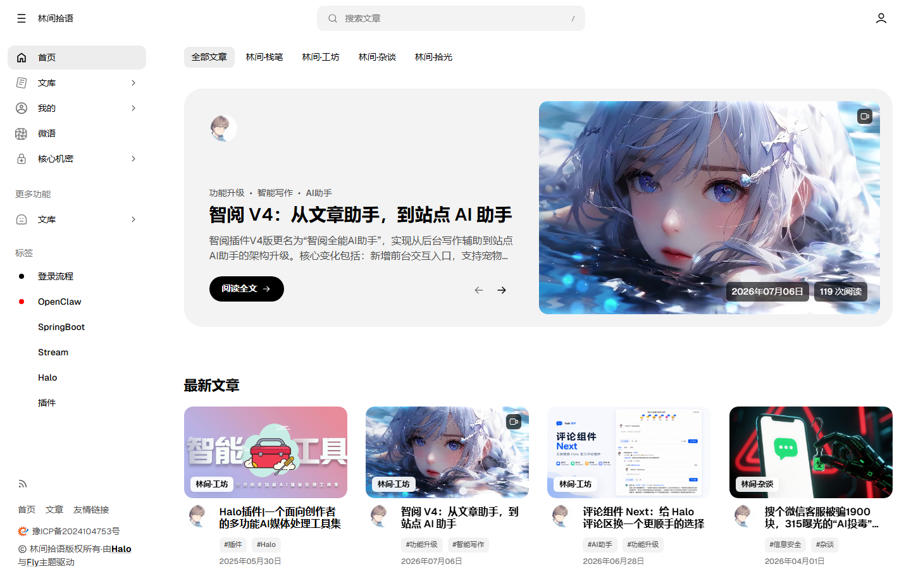
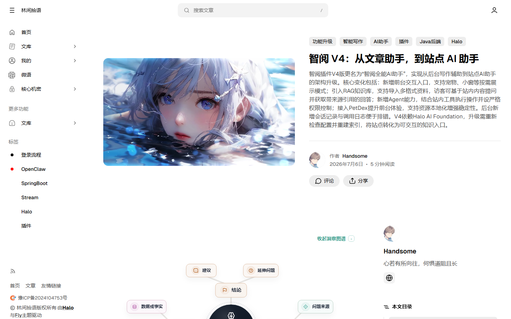
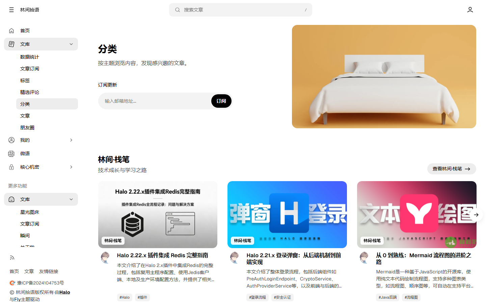
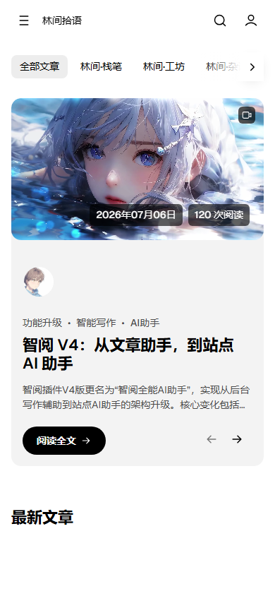

# Fly

Fly 是一款面向 Halo 2 的中文博客主题，视觉设计受 Aspect 启发。主题以内容阅读为核心，提供响应式侧栏、三种首页布局、深浅色模式，以及文章、作者、分类、标签、归档、瞬间、图库和友情链接等完整页面。

## 主题预览

### 桌面端首页



### 文章详情



### 分类页面



### 移动端首页

<p align="center">
  
</p>

## 主要功能

- 网格、横幅、轮播三种首页精选布局，可指定并排序最多 5 篇精选文章
- 首页模块自由排序，可按需显示最新文章、作者、订阅、分类专题和友情链接
- 桌面端固定侧栏与移动端导航，适配不同尺寸的桌面和移动设备
- 深色、浅色和跟随系统三种配色模式，支持自定义主题主色与辅色
- 文章目录、阅读时间、图片灯箱、分享、相关文章、评论和视频封面
- 分类、标签、归档、作者主页、瞬间、图库、友情链接与 RSS 朋友圈页面
- 所有作者、全屏封面、RSS 朋友圈和文章分栏自定义模板
- 统一状态码错误页面、认证页面和 Swup 无刷新页面切换
- Open Graph、结构化数据和语义化页面标题等基础 SEO 支持

## 环境要求

- Halo `>= 2.22.8`
- 本地开发需要 Node.js `>= 22.12.0` 与 pnpm

## 安装

1. 从 Releases 下载主题压缩包。
2. 进入 Halo 后台的“外观 → 主题”，上传压缩包并启用 Fly。
3. 打开主题设置，按需配置首页、导航、页面封面、配色和高级选项。
4. 如果从源码安装，请先执行 `pnpm install` 和 `pnpm build`，确保 `templates/` 与静态资源已经生成。

升级主题前建议备份主题配置。升级后如果样式没有立即更新，请清理浏览器缓存和 Halo 缓存后重试。

## 可选插件

Fly 本身可以显示基础文章和页面；以下功能需要对应 Halo 插件提供数据或组件：

| 功能     | 插件 / 扩展点            | 说明                                                                     |
| -------- | ------------------------ | ------------------------------------------------------------------------ |
| 搜索     | `PluginSearchWidget`     | 提供桌面端与移动端搜索入口                                               |
| 评论     | `PluginCommentWidget`    | 用于文章、单页、瞬间、图库和友链申请评论                                 |
| 友情链接 | `PluginLinks`            | 提供友情链接、首页友链分组和 RSS 朋友圈数据                              |
| 瞬间     | 瞬间插件                 | 提供瞬间列表、标签筛选与详情页数据                                       |
| 图库     | 图库插件                 | 提供图片分组、列表、详情和评论数据                                       |
| 邮件订阅 | Flow Post / 文章订阅插件 | 需提供 `/apis/api.flow.post.kunkunyu.com/v1alpha1/follows/-/submit` 接口 |

搜索、评论和首页友链会根据对应扩展点的可用状态显示。未安装兼容的订阅插件时，请在“基础信息”中关闭“启用订阅表单”；瞬间、图库和 RSS 朋友圈页面也需要先安装并配置对应插件。

## 主题配置

| 配置组   | 内容                                                                  |
| -------- | --------------------------------------------------------------------- |
| 基础信息 | 首页布局、精选文章、首页模块顺序、订阅、备案与首页友链                |
| 认证界面 | 登录、注册和找回密码页面背景图                                        |
| 主题页面 | 分类、标签、归档、瞬间、图库、友情链接和 RSS 朋友圈的标题、说明与封面 |
| 导航     | 主菜单、更多功能菜单、底部导航、精选标签和侧栏底部链接                |
| 配色设置 | 主题主色与辅色                                                        |
| 高级设置 | Swup 开关与页面切换超时时间                                           |

页脚始终保留站点版权以及 Halo 与 Fly 主题信息；主题后台不提供删除前端版权信息的选项。

## 自定义模板

| 类型 | 模板       | 用途                           |
| ---- | ---------- | ------------------------------ |
| 单页 | 所有作者   | 展示作者目录及每位作者的文章   |
| 单页 | 全屏封面   | 使用大幅封面的沉浸式单页       |
| 单页 | RSS 朋友圈 | 展示链接管理插件聚合的朋友文章 |
| 文章 | 分栏模板   | 使用正文与辅助内容分栏布局     |

在 Halo 后台创建或编辑单页、文章时选择对应模板。RSS 朋友圈页面需要先安装链接管理插件。

## 目录结构

```text
src/
  components/             # Vue 交互组件
  pages/                  # Astro / Thymeleaf 页面与片段源码
public/
  assets/                 # 手写样式、脚本、字体、图片与图标
unocss/
  preflights/             # 按页面和组件拆分的样式模块
  shortcuts/              # 可复用 UnoCSS shortcuts
scripts/                  # 构建、校验与页面截图脚本
screenshots/              # README 中使用的多页面演示图
templates/                # Astro 生成的 Halo 模板
annotation-setting.yaml   # 模型扩展字段
settings.yaml             # 主题设置表单
theme.yaml                # 主题元数据
screenshot.png            # Halo 主题预览图
```

源码和 Halo 产物之间是单向关系：

```text
src/pages/**/*.astro + src/components/**/*.vue + public/**
                         ↓ pnpm build
                 templates/**/*.html + templates/assets/**
```

Halo 的 `th:*`、Finder API 和主题配置表达式直接写在 Astro 页面中，Astro 在构建时原样保留。Vue 只用于需要浏览器状态的交互 Island，目前暗色模式切换器使用 Vue 实现。

## 开发

```bash
pnpm install
pnpm dev
```

`pnpm dev` 会监听 `src/`、`public/`、`unocss/`、构建脚本和主题配置。每次变更都会重新生成 UnoCSS，并由 Astro 重建 `templates/`；构建产物目录已从监听范围排除，避免循环构建。

## 构建

```bash
pnpm build
```

构建顺序如下：

1. 生成本地 Iconify SVG 到 `public/assets/icons/iconify/`。
2. 生成 UnoCSS 到 `public/assets/css/uno.css`。
3. 执行 `astro build`，覆盖生成 `templates/`。
4. 校验 Astro 源文件、Halo 模板和必需静态资源。

提交前运行：

```bash
pnpm lint
pnpm typecheck
pnpm build
```

## 说明

- 主题 UI 类名和 JS 钩子使用 `fly-` / `data-fly-*` 命名空间，减少与插件或正文内容冲突。
- `public/assets/css/uno.css` 和整个 `templates/` 都是生成内容；手写样式入口是 `public/assets/css/style.css` 与 `unocss/` 下的模块。
- 不要直接修改 `templates/`，否则下一次 `pnpm build` 会覆盖改动。
- 当前主题资源标识仍是 `theme-flying`，需要和当前主题目录名保持一致。

## 扩展字段

主题通过 `annotation-setting.yaml` 为 Halo 模型增加以下可选字段：

| 对象   | 字段                       | 用途                                             |
| ------ | -------------------------- | ------------------------------------------------ |
| 菜单项 | `fly_icon`                 | 设置侧栏菜单的 Iconify 图标                      |
| 用户   | `fly_qq`、`fly_wechat`     | 在作者资料卡中显示并支持点击复制                 |
| 用户   | `fly_email`、`fly_website` | 在作者资料卡与作者主页中显示联系方式             |
| 用户   | `fly_author_background`    | 设置首页作者卡片背景图，未设置时使用头像         |
| 文章   | `fly_video_cover`          | 使用视频作为文章卡片封面，图片封面作为加载前画面 |

## 许可证

Fly 使用 [GPL-3.0](https://www.gnu.org/licenses/gpl-3.0.en.html) 许可证。
